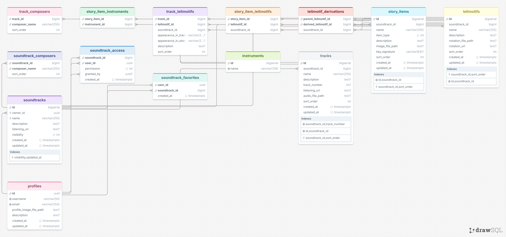
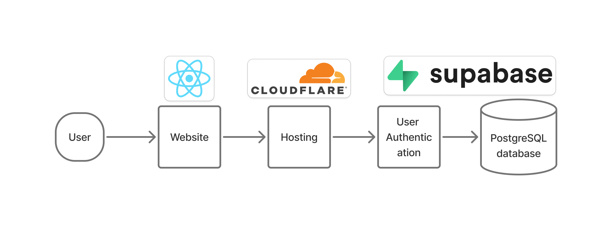

# Soundtracker

An app for developing your own soundtracks or organizing and dissecting other soundtracks.

### Users

- Users sign in through Supabase Auth, which manages passwords and authentication.
- Each user has a username, email, optional profile picture, and optional description.
- Users can create soundtracks, open profiles, view other users' profiles, share soundtracks, and favorite soundtracks.

### Soundtracks

- Each soundtrack has a name, one or more composers, an optional description, an optional listening-platform link, and a selectable name color.
- **Story view** organizes characters, settings, ideas, and other story items. Each item can have a name, optional description and picture, and associations with leitmotifs, instruments, key signatures, and tracks. Names can have their own color.
- **Leitmotif view** lists motifs with a name, optional description and sheet music or MIDI representation. Motifs can be associated with story items and derived from other motifs. Names can have their own color.
- **Tracklist** contains tracks with a name, one or more composers, optional description, and optional listening link. Tracks can list leitmotifs and where each appears in the track and in the film, show, game, or other work. Names can have their own color.
- Soundtracks record their creation and modification dates.
- **Visibility and access:**
  - **Open:** Other users can view and edit the soundtrack; only its owner can delete it.
  - **Public:** Other users can view it; only its owner can edit or delete it.
  - **Private:** Only its owner can view and edit it unless the owner grants specific users view or edit access. Only the owner can delete it.

### Other features

- All characters, settings, ideas, leitmotifs, and tracks have their own pages with their full details.
- Users with permission can create, edit, and delete soundtrack pages.
- Soundtracks can be exported as a Markdown file and imported again as a new private copy with internal page links preserved.
- Users can search for and view other users' public and open projects.

### Database design

- [`soundtracker-schema.sql`](soundtracker-schema.sql) describes the normalized PostgreSQL data model for Supabase.
- [`supabase-app-setup.sql`](supabase-app-setup.sql) sets up the website's profile trigger, Row Level Security policies, and app-facing soundtrack document, access, and favorite tables.
- Supabase Auth manages passwords and sign-in. Each `profiles` row uses the matching Auth user UUID and stores the user's username, email, profile image path, and description. The public profile view omits email addresses.
- The website stores each complete soundtrack, including its story items, leitmotifs, tracks, links, and chosen name colors, as JSONB in `soundtracker_soundtrack_documents`. The owner, visibility, and timestamps are also indexed as regular columns for access checks and browsing.
- `soundtracker_document_access` stores view or edit grants. `soundtracker_favorites` stores each user's saved soundtracks. Row Level Security restricts access to owners, invited users, and soundtracks marked public or open.
- The normalized tables in `soundtracker-schema.sql` document the relational model. The current website uses the JSONB document table so the app can save and restore a whole soundtrack and its internal links together.
- The browser uses only the Supabase URL and publishable key. Keep secret keys and Supabase management tokens out of `VITE_` variables and client code.

### Tech stack

- TypeScript and React for the frontend.
- Vite to build and deploy.
- Supabase Auth and PostgreSQL for authentication and data storage.
- Cloudflare Pages for web hosting.

### Run locally

1. In the Supabase SQL Editor, run `soundtracker-schema.sql` if the normalized base tables are not already installed.
2. Run `supabase-app-setup.sql` to create the profile trigger and website tables and policies.
3. Keep `.env` in the project root and set `VITE_PUBLIC_SUPABASE_URL` and `VITE_PUBLIC_SUPABASE_PUBLISHABLE_KEY`. The `SUPABASE_SECRET_KEY` and `SUPABASE_ACCESS_TOKEN` values are server-side credentials and must never be exposed in browser code.
4. Run `npm install`, then `npm run dev` and open the local URL Vite prints.
5. Build the production site with `npm run build`.

## To do

- Replace placeholder images and icons with final artwork.
- Add an about page.
- Consider adding track types such as score or original song.
